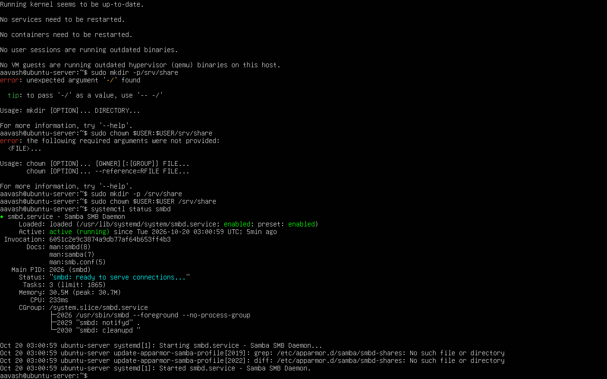
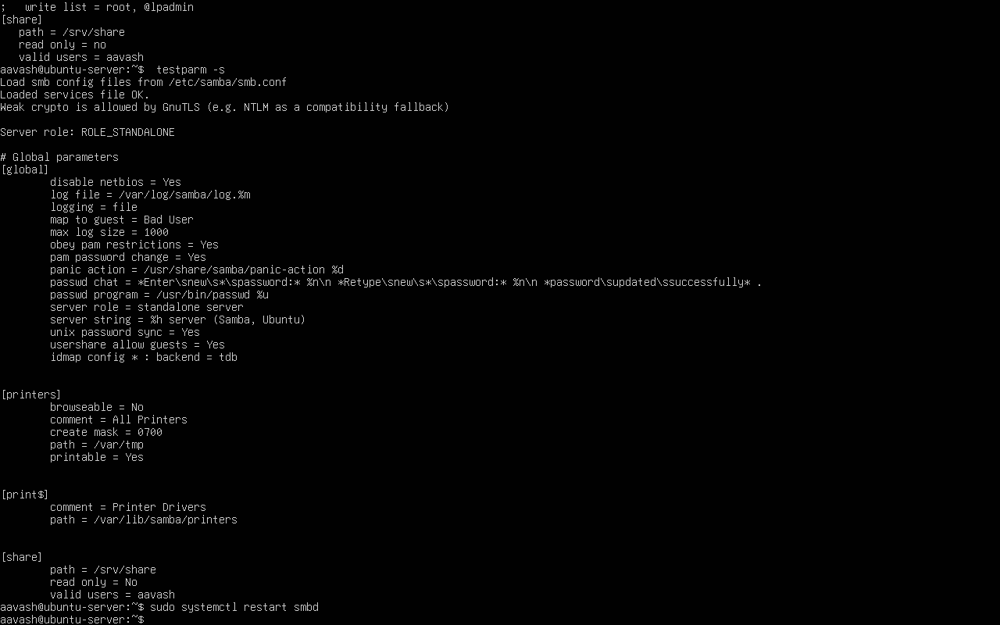
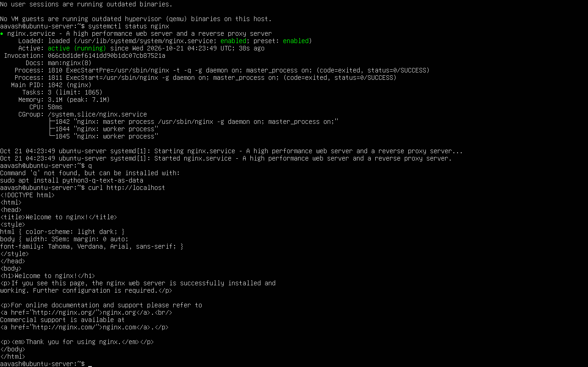
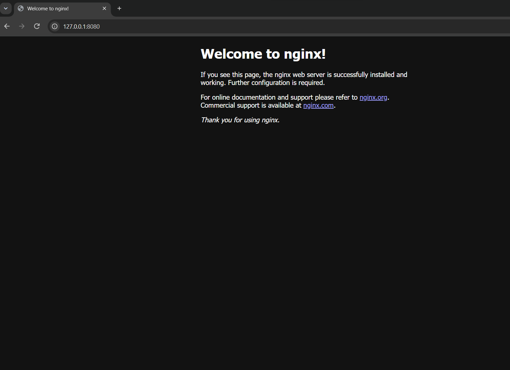
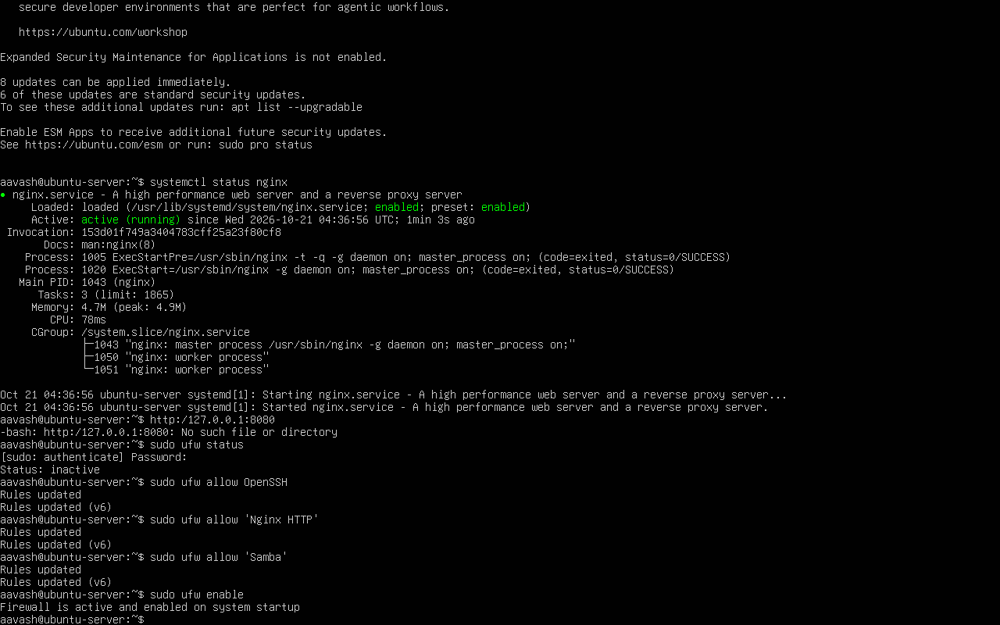
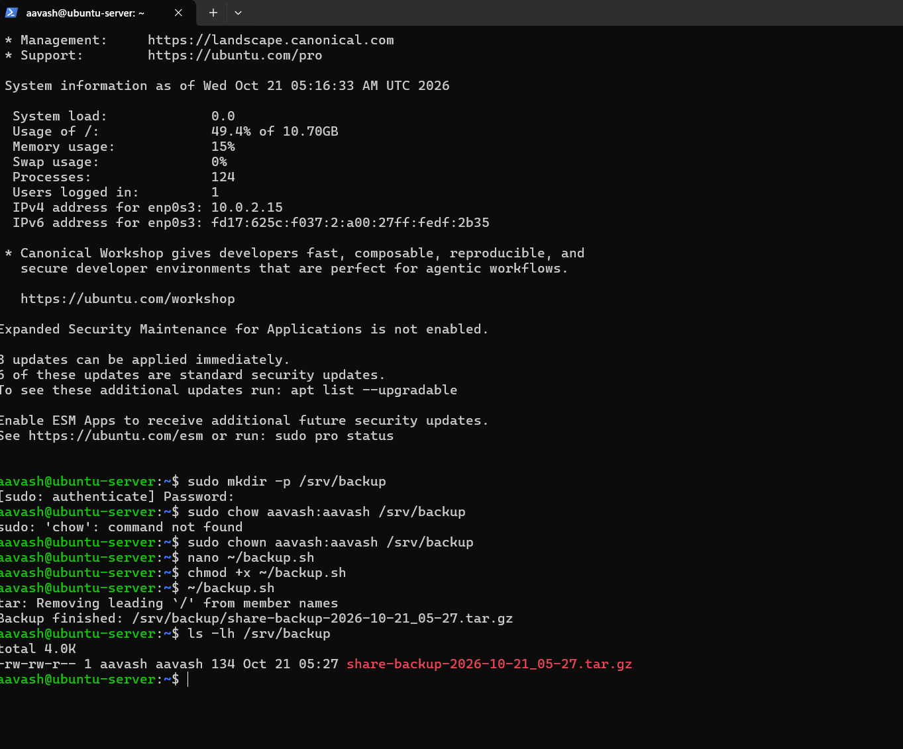

# Homelab: Ubuntu Server

Das ist mein Übungsprojekt für die Ausbildung zum Fachinformatiker für Systemintegration.
Ich habe einen Ubuntu Server in einer virtuellen Maschine eingerichtet.

## Ziel

Ich will lernen, wie man einen Linux-Server installiert, sichert und betreibt.

## Umgebung

| Teil | Wert |
|---|---|
| Programm | VirtualBox auf Windows 11 |
| System | Ubuntu Server 26.04.1 LTS |
| RAM / CPU | 2 GB / 2 CPUs |
| Festplatte | 25 GB (LVM) |
| Netzwerk | NAT |

## Was ich gemacht habe

### 1. Samba (Dateifreigabe)

Ich habe den Ordner `/srv/share` freigegeben. Nur der Benutzer `aavash` darf darauf zugreifen.
Ich habe den Zugriff mit `smbclient` getestet. Ich konnte mich anmelden und einen Ordner anlegen.





### 2. Nginx (Webserver)

Ich habe Nginx installiert und getestet. In VirtualBox habe ich eine Portweiterleitung eingerichtet (Port 8080 auf Port 80).
Jetzt sehe ich die Webseite im Browser auf meinem Windows-Laptop.





### 3. Firewall (ufw)

Ich habe zuerst SSH, Nginx und Samba erlaubt. Danach habe ich die Firewall eingeschaltet.
So sperre ich mich nicht selbst aus.

```
sudo ufw allow OpenSSH
sudo ufw allow 'Nginx HTTP'
sudo ufw allow 'Samba'
sudo ufw enable
```




### 4. SSH vom Windows-Laptop

Ich habe eine zweite Portweiterleitung eingerichtet (Port 2222 auf Port 22).
Zuerst ging die Verbindung nicht ("Connection refused"). Es gab zwei Fehler:

- Der SSH-Dienst lief nicht. Ich habe ihn mit `sudo systemctl enable --now ssh` gestartet.
- Die Portweiterleitung für SSH fehlte. Ich habe sie hinzugefügt.

Danach hat die Verbindung funktioniert:

```
ssh -p 2222 aavash@127.0.0.1
```


### 5. Backup-Skript mit Cron

Das Bash-Skript `backup.sh` macht ein Archiv (`.tar.gz`) vom Ordner `/srv/share` und speichert es in `/srv/backup`.
Backups, die älter als 7 Tage sind, werden gelöscht.
Cron startet das Skript jeden Tag um 02:00 Uhr.

```
0 2 * * * /home/aavash/backup.sh >> /home/aavash/backup.log 2>&1
```




## Was ich gelernt habe

- Wie man Dienste installiert und mit `systemctl` prüft.
- Wie die Firewall funktioniert. Man erlaubt SSH zuerst.
- Wie man Fehler sucht. Bei "Connection refused" habe ich Dienst und Portweiterleitung geprüft.
- Wie man ein Backup-Skript schreibt und automatisch startet.
- Wie man Git und GitHub benutzt (neu für mich).

## Nächste Schritte

- Backup wiederherstellen und testen
- Snapshot der virtuellen Maschine erstellen
- Windows Server als zweite virtuelle Maschine

## Dateien

- `config/smb.conf`: Samba-Konfiguration
- `config/backup.sh`: Backup-Skript
- `screenshots/`: Bilder von den Tests
